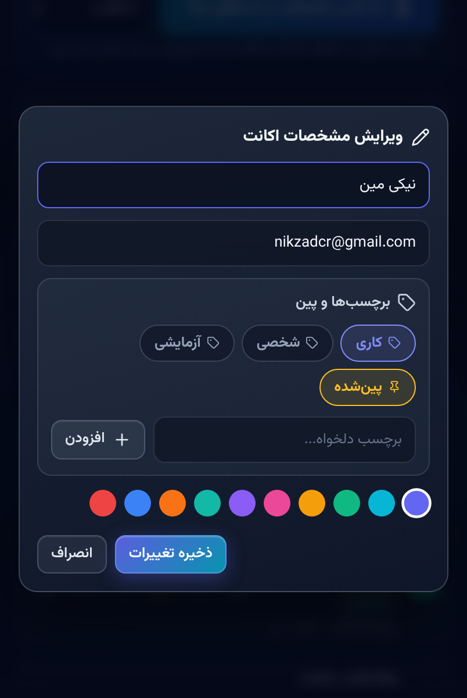
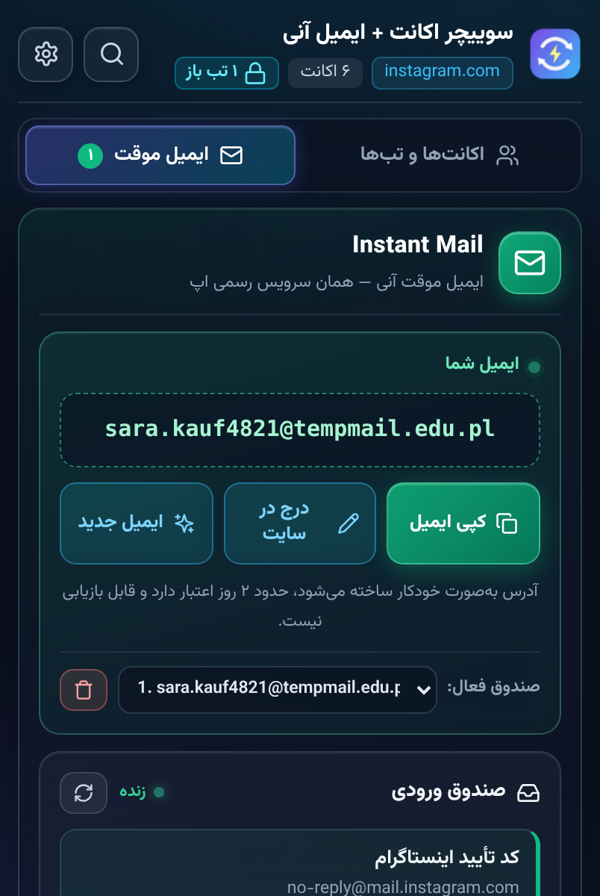
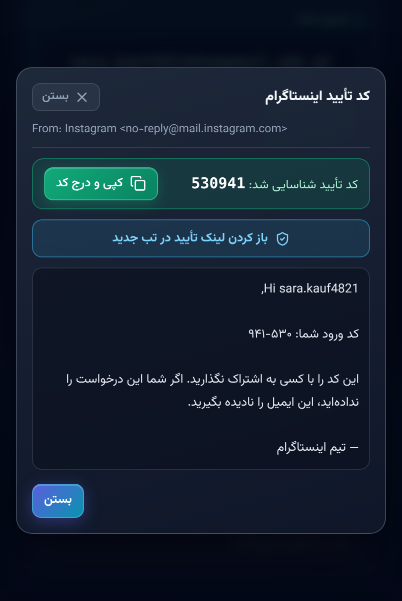
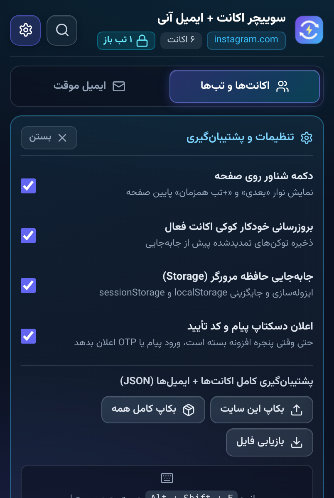
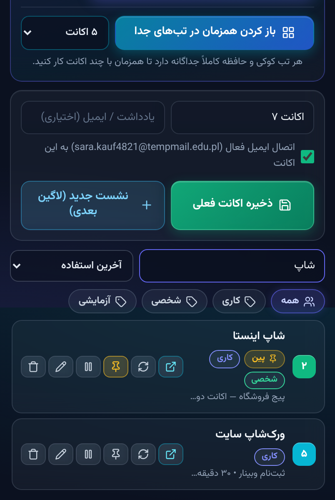
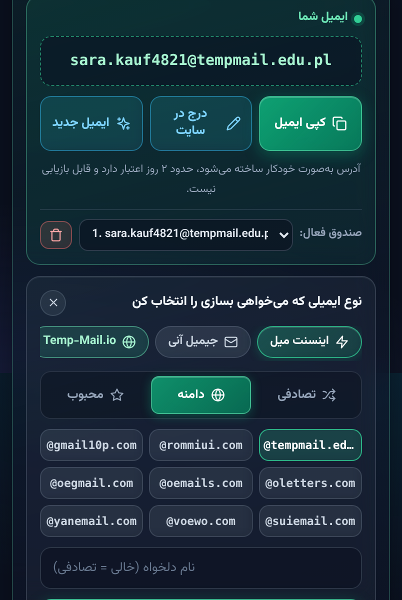

# AI Multi-Account Switcher + Instant Temp Mail

**A Chrome/Edge extension (Manifest V3) that keeps 30+ accounts per site and switches between them in one click — with a built-in temp-mail engine that catches verification codes automatically.**

[English](README.en.md) · [نسخه فارسی](README.md)

---

## Why this extension?

Working with several accounts on the same site usually means logging out, logging back in, and sometimes solving captchas — every single time. This extension saves each account's session once, and after that switching is **one click**. You can even open several accounts **at the same time, in separate isolated tabs**.

The second problem is throwaway sign-ups: every new site wants an email, and your real inbox fills up with newsletters. The built-in temp-mail panel creates a disposable address on the spot, keeps the inbox live, and **detects the verification code (OTP) automatically** — copy it with one click or inject it straight into the site's input field.

> The UI of the extension is in Persian (فارسی). The screenshots show the Persian interface; all mail providers and APIs work internationally.

## Contents

- [Features](#features)
- [Installation](#installation)
- [Usage](#usage)
- [Keyboard shortcuts](#keyboard-shortcuts)
- [How it works](#how-it-works)
- [Screenshots](#screenshots-1)
- [FAQ](#faq)
- [Changelog](#changelog)

---

## Features

### 1. Account management & switching

- **Store 30+ accounts per site** — cookies, `localStorage`, `sessionStorage` and (optionally) IndexedDB are captured per account.
- **One-click switching in the current tab** — click a card and that account's session is restored; no re-login.
- **Open multiple accounts at once in isolated tabs** — in batches (3 / 5 / 10 / all) or one by one. Each tab gets a numbered title: `[1] …`, `[2] …`.
- **Quick switcher palette** — `Alt+Shift+F` opens an on-page search over accounts from **all sites**. `Enter` switches the current tab, `Ctrl+Enter` opens a new isolated tab, `Esc` closes.
- **Labels, pinning and sorting** — built-in presets plus custom labels, pin frequently used accounts, sort by last used / name / newest, and filter with colored chips.
- **Live list search** — the account list filters as you type (name, note, email, labels).
- **Color & note per account** — ten preset colors for quick visual separation.
- **Floating on-page widget** — switch / open-in-new-tab / search buttons stay available at the bottom of the site; can be disabled or moved.

<table>
<tr>
<td></td>
<td></td>
</tr>
</table>

### 2. Temp mail & verification codes

- **Five providers, no sign-up:**

  | Provider | Notes |
  |---|---|
  | Instant Mail (HD) | 9 dedicated domains such as `tempmail.edu.pl`, `rommiui.com` |
  | Instant Gmail | `gmail.com` / `googlemail.com` addresses served by the app's second server |
  | Temp-Mail.io | public, dynamic domains |
  | Mail.tm / Mail.gw | well-known public Hydra servers |

- **Three creation modes (like the Instant Mail app):** random, pick a domain (+ custom name), or popular domains.
- **Live inbox** — polls every 5 seconds; the unread count is badged on the mail tab.
- **Automatic OTP detection** — extracts 4–8 digit codes, including messages that use **Persian/Arabic digits** or spaced groups (`۵۳۰ ۹۴۱` → `530941`).
- **One-click copy & fill** — copies the code and, if a code input is focused on the page, fills it directly.
- **Verification links always open in a new tab** — opening them over the sign-up tab can invalidate one-time tokens; this extension never does that.
- **Desktop notifications** — even with the popup closed, inboxes are checked every minute; if a new message contains a code, it is shown large in the notification, which stays until clicked. Clicking it opens the popup.
- **Mailbox history** — several addresses are kept side by side; switch from a dropdown.

<table>
<tr>
<td></td>
<td></td>
</tr>
</table>

### 3. Settings & data safety

- **Everything is local** — accounts and mail are stored only in `chrome.storage.local` of your browser profile. There is no middleman server and nothing is uploaded anywhere.
- **Backup & migrate** — export accounts of one site or all sites as JSON and restore them elsewhere.
- **Behavior toggles** — floating widget, auto session sync, include page storage, desktop notifications.

---

## Installation

1. Download the latest version from [Releases](../../releases) and unzip it.
2. Open `chrome://extensions` in Chrome or Edge.
3. Turn on **Developer mode** (top-right).
4. Click **Load unpacked** and select the extracted folder.

> **Updating from an older version?** Overwrite the previous folder with the new files and press **Reload** on the extension card in `chrome://extensions`. An unpacked extension's ID depends on its folder path — moving the folder changes the ID and the old data will not be visible.

## Usage

### Save the current account
Log into the site → open the popup → type a name → **Save active account**. The session can now be restored with one click at any time. If you enable "link the active mail to this account", the currently selected temp mailbox is attached to it as well.

### Switching & parallel work
- Click a card = switch in the current tab.
- The ↗ button on a card = open that account in a **new isolated tab** (next to your current one).
- **"Open simultaneously in separate tabs"** = batch-open as many accounts as selected in the side menu.

### Create temp mail & get the code
Open the **Temp Mail** tab → pick a service and domain (or random) → **Create new email** → the address is copied automatically → paste it into the site's form → the inbox updates by itself; copy or inject the code with one click.

### Quick switcher
Press `Alt+Shift+F` anywhere on a supported page, type part of an account name, then `Enter` (current tab) or `Ctrl+Enter` (new isolated tab).

## Keyboard shortcuts

| Shortcut | Action |
|---|---|
| `Alt + Shift + F` | Quick account search palette |
| `Alt + Shift + S` | Switch to the next account in the current tab |
| `Alt + Shift + A` | Switch to the previous account in the current tab |

Shortcuts can be changed at `chrome://extensions/shortcuts`.

---

## How it works

Three moving parts, briefly:

**1. Session capture & restore.** On save, the extension reads the site's cookies via `chrome.cookies` and grabs `localStorage` / `sessionStorage` through `chrome.scripting.executeScript`, storing them locally. On switch, the current values are wiped and the target account's values are injected, then the page reloads — the site simply sees its old session again.

**2. Isolated parallel tabs.** For every isolated tab the extension installs a `declarativeNetRequest` session rule scoped to that `tabId`, keeping cookie headers (and part of page storage) separate. Two tabs of the same site therefore behave like two different browsers — inside one window.

**3. Temp-mail engine.** Each provider has a small client (the Instant Mail app API was reconstructed from the app bundle with its `x-app-key` header and charSwap/base64 encoding; Temp-Mail.io and the Hydra servers use their public endpoints). The popup polls the active mailbox every 5 seconds; a `chrome.alarms` job checks all mailboxes every minute for desktop notifications. Message bodies are scanned with a set of patterns — including Persian/Arabic digit normalization — to find OTP codes and verification links.

## Screenshots

| | |
|---|---|
|  |  |
|  |  |
|  |  |
|  |  |

## FAQ

**Does it work with Google sites (YouTube, Gmail, …)?**
Google sessions are unified across tabs, so isolated parallel tabs are not reliable there. The extension detects this, shows a warning, and recommends single-tab switching for those sites.

**Where is my data? What if I uninstall?**
Everything lives in the local storage of your browser profile. Uninstalling the extension deletes the saved accounts. Export a JSON backup from Settings before uninstalling or migrating.

**Is opening 30 tabs at once realistic?**
It consumes a lot of RAM, and anti-bot systems (like Cloudflare) may throw captchas at dozens of simultaneous requests from one IP. Batches of 3–5 work best in practice.

**Why shouldn't I log out from inside the site?**
Logging out invalidates the session token on the server, so the stored account stops working. To end a parallel session, just close its tab.

**How long does a temp address live?**
Depending on the provider, addresses usually last around 2 days and cannot be recovered. Don't use them for anything important.

## Changelog

- **v4.0.0** — Removed the personal-Gmail connection feature (OAuth/feed linking and alias addresses on your own Gmail). The temp-mail engine with its five server-side providers is unchanged. Fixed account-card layout with many labels. Cleaned up manifest permissions (`identity` removed).
- **v3.5 – v3.6** — Various personal-Gmail connection modes (removed in v4).
- **v3.3** — On-page quick switcher, labels/pinning/sorting, desktop notifications for mail and OTP.
- **v3.2** — Dark glass theme, SVG icons everywhere, copy-button fix, verification links in a new tab, larger fonts.
- **v3.1** — Instant Mail engine with multiple providers and a live inbox.

## License

Released under the [MIT](LICENSE) license.
