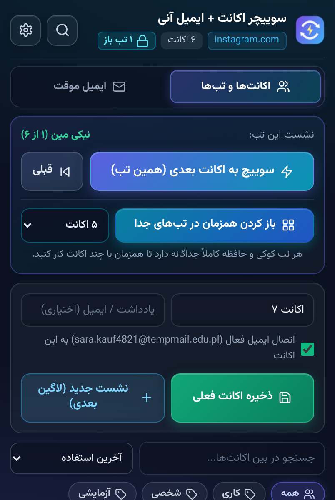
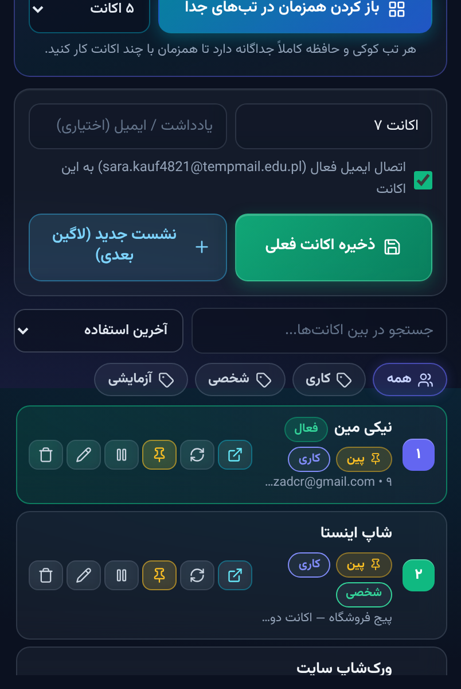
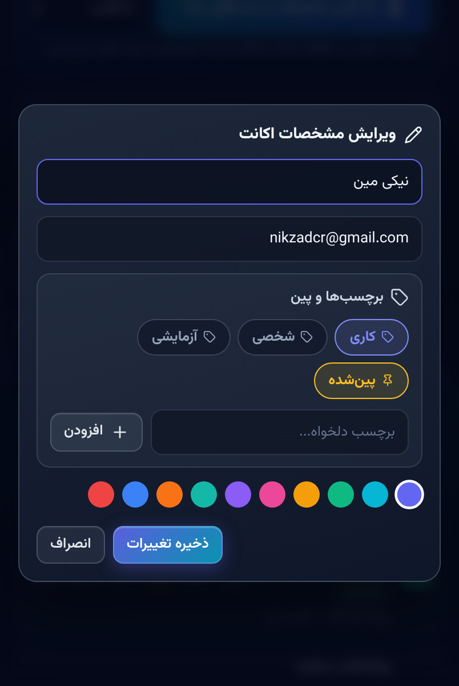
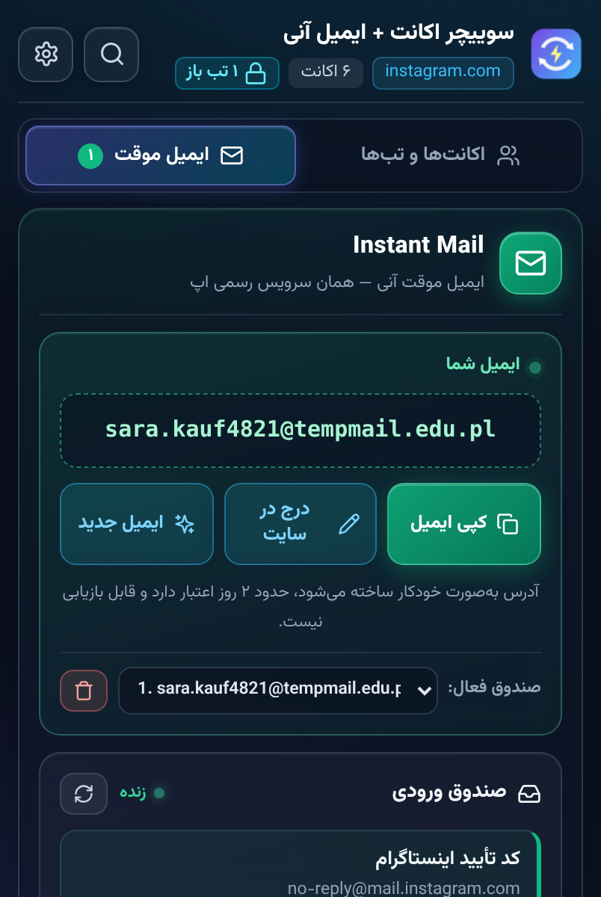
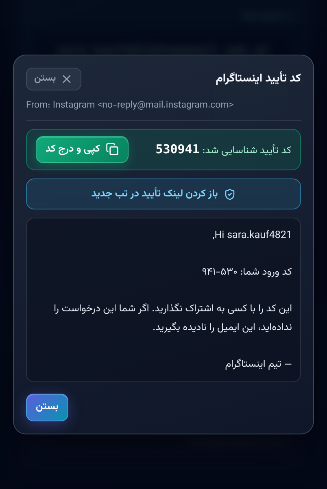
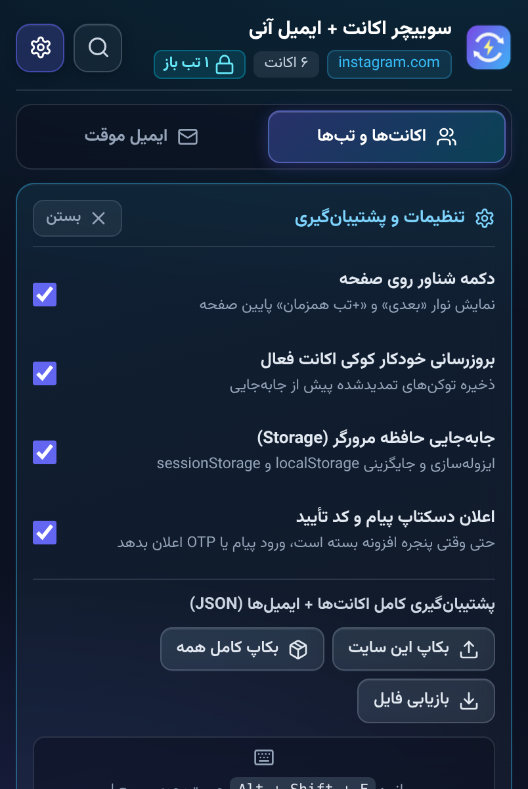
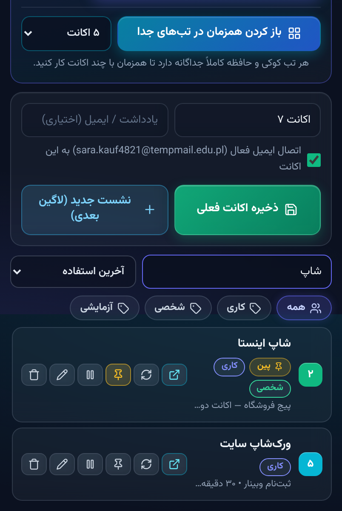
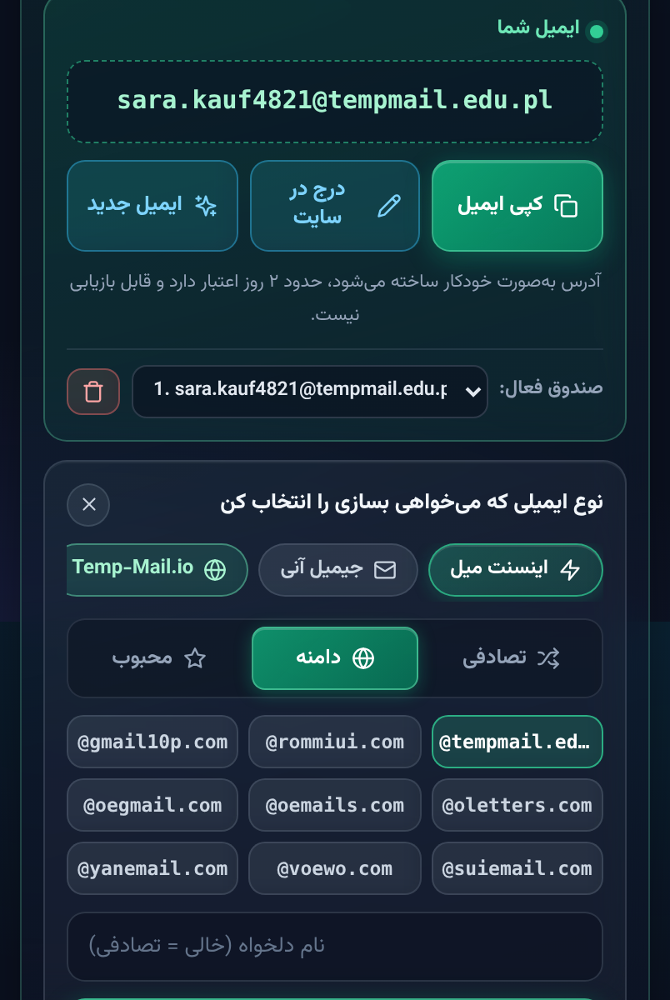

# سوییچر مولتی‌اکانت + ایمیل موقت

**افزونه کروم/اج (Manifest V3) برای مدیریت ده‌ها اکانت روی یک سایت، بدون خروج و ورود دوباره — به‌همراه موتور ایمیل موقت و ایجنت ثبت‌نام خودکار با حل کپچا و درج کد تأیید.**

[نسخه فارسی](README.md) · [English](README.en.md)

---

## چرا این افزونه؟

اگر با چند اکانت روی یک سایت کار کنید (اینستاگرام، چت‌هوش مصنوعی، فروم‌ها و…)، هر بار سوییچ یعنی خروج، ورود دوباره و گاهی کپچا. این افزونه نشست هر اکانت را یک‌بار ذخیره می‌کند و بعد از آن، جابه‌جایی بین اکانت‌ها **یک کلیک** است — بدون لاگین دوباره. حتی می‌توانید چند اکانت را **همزمان در تب‌های جدا و ایزوله** باز کنید.

مشکل دوم، ثبت‌نام‌های آزمایشی است: برای هر سایت جدید یک ایمیل لازم دارید و صندوق واقعی‌تان پر از تبلیغ می‌شود. بخش ایمیل موقت افزونه در همان پنجره، آدرس یک‌بارمصرف می‌سازد، صندوق ورودی را زنده نگه می‌دارد و **کد تأیید را خودکار تشخیص می‌دهد** — با یک کلیک کپی یا مستقیم داخل فیلد سایت درج می‌شود.

در نسخه ۵ یک قدم جلوتر: **ایجنت ثبت‌نام** خودش فرم سایت را پیدا می‌کند، ایمیل، نام کاربری و رمز را پر می‌کند، کپچا را حل می‌کند، فرم را ثبت می‌کند، کد تأیید را از ایمیل برمی‌دارد و در صفحه می‌گذارد — و مشخصات اکانت را در خزانه ذخیره می‌کند.

## فهرست

- [قابلیت‌ها](#قابلیت‌ها)
- [نصب](#نصب)
- [راهنمای استفاده](#راهنمای-استفاده)
- [کلیدهای میانبر](#کلیدهای-میانبر)
- [این افزونه چطور کار می‌کند؟](#این-افزونه-چطور-کار-میکند)
- [اسکرین‌شات‌ها](#اسکرین‌شات‌ها)
- [سؤالات پرتکرار](#سؤالات-پرتکرار)
- [تاریخچه نسخه‌ها](#تاریخچه-نسخه‌ها)

---

## قابلیت‌ها

### ۱) مدیریت و سوییچ اکانت‌ها

- **ذخیره ۳۰+ اکانت برای هر سایت** — کوکی، `localStorage`، `sessionStorage` و در صورت نیاز IndexedDB هر نشست جداگانه نگه‌داری می‌شود.
- **سوییچ ۱-کلیکی در همین تب** — کلیک روی هر کارت یعنی نشست همان اکانت در تب فعلی فعال شود؛ رفرش کامل لازم نیست.
- **باز کردن همزمان چند اکانت در تب‌های ایزوله** — دسته‌ای (۳ / ۵ / ۱۰ / همه) یا تک‌به‌تک با دکمه تبِ ایزوله روی هر کارت. هر تب عنوان شماره‌دار می‌گیرد: `[۱] …`، `[۲] …`.
- **جست‌وجوی سریع (پالت درون‌صفحه‌ای)** — با `Alt+Shift+F` پالتی روی همان صفحه باز می‌شود؛ بین اکانت‌های **همه سایت‌ها** جست‌وجو می‌کند. `Enter` سوییچ در تب فعلی، `Ctrl+Enter` باز کردن در تب ایزوله جدید، `Esc` بستن.
- **برچسب‌ها، پین و مرتب‌سازی** — برچسب آماده «کاری / شخصی / آزمایشی» + برچسب دلخواه، پین‌کردن اکانت‌های پراستفاده، مرتب‌سازی بر اساس آخرین استفاده / نام / جدیدترین، و فیلتر برچسب با چیپ‌های رنگی.
- **جست‌وجوی زنده در لیست** — تایپ کنید تا لیست همان لحظه فیلتر شود (نام، یادداشت، ایمیل و برچسب‌ها).
- **رنگ و یادداشت برای هر اکانت** — ۱۰ رنگ آماده برای تفکیک چشمی.
- **نوار شناور روی صفحه** — دکمه‌های سوییچ/تب جدید/جست‌وجو همیشه پایین سایت در دسترس است؛ قابل خاموش‌کردن و جابه‌جایی.

<table>
<tr>
<td></td>
<td></td>
</tr>
</table>

### ۲) ایمیل موقت و کد تأیید

- **۵ سرویس آماده، بدون ثبت‌نام:**
  | سرویس | توضیح |
  |---|---|
  | اینسنت میل (HD) | ۹ دامنه اختصاصی مثل `tempmail.edu.pl` و `rommiui.com` |
  | جیمیل آنی | آدرس‌های `gmail.com` / `googlemail.com` روی سرور دوم اپ |
  | Temp-Mail.io | دامنه‌های پویا و عمومی |
  | Mail.tm / Mail.gw | سرورهای عمومی شناخته‌شده |
- **سه حالت ساخت مثل اپ Instant Mail:** تصادفی، انتخاب دامنه (+ نام دلخواه) و دامنه‌های محبوب.
- **صندوق ورودی زنده** — هر ۵ ثانیه خودکار چک می‌شود؛ شماره پیام خوانده‌نشده روی تب ایمیل نشان داده می‌شود.
- **تشخیص خودکار کد تأیید (OTP)** — کد ۴ تا ۸ رقمی از متن پیام بیرون کشیده می‌شود، حتی وقتی سایت‌های ایرانی آن را با **ارقام فارسی** یا جداکننده‌های خاص می‌فرستند (`۵۳۰ ۹۴۱` → `530941`).
- **کپی و درج یک‌کلیکی** — دکمه روی هر پیام، کد را کپی و اگر فیلد کد در صفحه باز باشد مستقیم درج می‌کند.
- **لینک‌های تأیید همیشه در تب جدید** — باز شدن لینک روی تب فرم ثبت‌نام، توکن یک‌بارمصرف را باطل می‌کند؛ این افزونه همیشه تب جدا باز می‌کند.
- **اعلان دسکتاپ** — حتی وقتی پنجره افزونه بسته است، هر دقیقه صندوق‌ها چک می‌شوند؛ اگر پیام تازه کد داشته باشد، کد درشت در خود اعلان دیده می‌شود و اعلان تا کلیک باز می‌ماند. کلیک روی اعلان، پنجره افزونه را باز می‌کند.
- **تاریخچه صندوق‌ها** — چند ایمیل همزمان نگه داشته می‌شود و از منوی کشویی بین‌شان جابه‌جا می‌شوید.

<table>
<tr>
<td></td>
<td></td>
</tr>
</table>

### ۳) ایجنت ثبت‌نام خودکار

- **تشخیص خودکار فرم ثبت‌نام** — فیلدهای ایمیل، نام کاربری، رمز، تکرار رمز، چک‌باکس قوانین و دکمه ثبت‌نام با بررسی نوع، نام، `placeholder` و متن برچسب‌ها پیدا می‌شوند؛ روی سایت‌های React/Vue هم درست مقداردهی می‌شود.
- **پر کردن یک‌کلیکی با داده‌های امن** — یوزرنیم تصادفی و رمز قوی (حروف بزرگ/کوچک + عدد + نماد، تولیدشده با `crypto.getRandomValues`) با یک دکمه ساخته و پر می‌شوند؛ چک‌باکس «قوانین را می‌پذیرم» هم خودش تیک می‌خورد.
- **حل کپچا** — reCAPTCHA v2/Enterprise، hCaptcha و Cloudflare Turnstile پشتیبانی می‌شوند:
  - بدون سرویس سولور: ایجنت همه‌ی کارهای دیگر را انجام می‌دهد و برای تیک زدن کپچا دستی صبر می‌کند؛ شما حل می‌کنید و «ادامه» می‌زنید.
  - با سرویس سولور (CapSolver یا 2Captcha): توکن با API سرویس ساخته و در ویجت تزریق می‌شود (مقداردهی `g-recaptcha-response` و فراخوانی callback).
- **ثبت خودکار فرم** — دکمه ثبت‌نام بعد از تکمیل کپچا کلیک می‌شود (قابل خاموش‌کردن).
- **گرفتن خودکار کد تأیید** — تا ۳ دقیقه صندوق ایمیل چک می‌شود؛ کد پیدا که شد در پاپ‌آپ نشان داده می‌شود و اگر فیلد کد در صفحه باز باشد، خودکار درج می‌شود. لینک‌های تأیید هم استخراج و با دکمه «باز کن» در تب جدید باز می‌شوند.
- **خزانه حساب‌ها** — هر ثبت‌نام با سایت، ایمیل، یوزرنیم و رمز در خزانه ذخیره می‌شود؛ جست‌وجو، کپی هر فیلد، نمایش/پنهان‌کردن رمز، حذف و خروجی JSON همه‌ی حساب‌ها.

<table>
<tr>
<td></td>
<td></td>
</tr>
</table>

### ۴) تنظیمات و امنیت داده

- **همه‌چیز لوکال است** — اکانت‌ها، خزانه ایجنت و ایمیل‌ها فقط در `chrome.storage.local` همان مرورگر ذخیره می‌شوند؛ هیچ سرور واسطی وجود ندارد و هیچ داده‌ای جایی ارسال نمی‌شود. کلید API سولور کپچا هم فقط روی مرورگر خودتان می‌ماند.
- **پشتیبان‌گیری و انتقال** — خروجی JSON از اکانت‌های یک سایت یا همه سایت‌ها، و بازگرداندن آن روی مرورگر دیگر.
- **تنظیم رفتار** — خاموش/روشن‌کردن نوار شناور، همگام‌سازی خودکار نشست، شمول حافظه (Storage) و اعلان‌های دسکتاپ.

---

## نصب

1. آخرین نسخه را از بخش [Releases](../../releases) دانلود کنید و از حالت فشرده خارج کنید.
2. در کروم/اج به `chrome://extensions` بروید.
3. **Developer mode** را بالا-راست صفحه روشن کنید.
4. **Load unpacked** را بزنید و پوشه استخراج‌شده را انتخاب کنید.

> **به‌روزرسانی از نسخه قبلی؟** فایل‌های جدید را روی همان پوشه قبلی کپی کنید و در `chrome://extensions` دکمه **Reload** کارت افزونه را بزنید. شماره شناسه افزونه به مسیر پوشه بستگی دارد؛ اگر پوشه را جابه‌جا کنید، افزونه با شناسه جدید نصب می‌شود و داده‌های نسخه قبل را نمی‌بیند.

## راهنمای استفاده

### ذخیره اکانت فعلی
وارد سایت شوید و لاگین کنید ← پنجره افزونه را باز کنید ← نام دلخواه بنویسید ← **«ذخیره اکانت فعال»**. از این به بعد همین نشست با یک کلیک برمی‌گردد. اگر گزینه «اتصال ایمیل فعال به این اکانت» را روشن کنید، صندوق ایمیل فعالِ افزونه هم به همین اکانت گره می‌خورد.

### سوییچ و کار همزمان
- کلیک روی کارت = سوییچ در تب فعلی.
- دکمه ↗ روی هر کارت = باز کردن همان اکانت در یک **تب ایزوله جدید** (کنار اکانت فعلی).
- **«باز کردن همزمان در تب‌های جدا»** = گروهی، به تعداد انتخابی منوی کناری.

### ثبت‌نام خودکار با ایجنت
تب **ایجنت** ← صفحه ثبت‌نام سایت را باز کنید ← ایمیل موقت را انتخاب یا بسازید («ایمیل جدید») ← یوزرنیم و رمز خودکار ساخته‌شده را ببینید ← **«شروع ایجنت»**. ایجنت فرم را پیدا و پر می‌کند؛ اگر کپچا باشد، یا خودش حلش می‌کند (سولور) یا از شما صبر می‌کند و با دکمه «کپچا را حل کردم، ادامه بده» جلو می‌رود. بعد از ثبت، کد تأیید خودکار از ایمیل گرفته و در صفحه درج می‌شود و اکانت در خزانه ذخیره می‌شود. برای ثبت بعدی، صفحه ثبت‌نام را دوباره باز کنید و «ایمیل جدید» + «شروع ایجنت».

### ساخت ایمیل موقت و گرفتن کد
تب **ایمیل موقت** ← سرویس و دامنه را انتخاب کنید (یا تصادفی) ← **«ساخت ایمیل جدید»** ← آدرس خودکار کپی می‌شود ← آن را در فرم سایت بچسبانید ← صندوق ورودی خودش پیام را می‌آورد؛ کد تأیید را با یک کلیک کپی/درج کنید.

### جست‌وجوی سریع
در هر جای صفحه `Alt+Shift+F` بزنید، چند حرف از نام اکانت را تایپ کنید، `Enter` یا `Ctrl+Enter`.

## کلیدهای میانبر

| میانبر | کار |
|---|---|
| `Alt + Shift + F` | پالت جست‌وجوی سریع اکانت‌ها |
| `Alt + Shift + S` | سوییچ به اکانت بعدی در تب فعلی |
| `Alt + Shift + A` | سوییچ به اکانت قبلی در تب فعلی |

میانبرها از `chrome://extensions/shortcuts` قابل تغییرند.

---

## این افزونه چطور کار می‌کند؟

بدون پرداخت به جزئیات، معماری سه بخش دارد:

**۱. ثبت و بازگردانی نشست.** موقع ذخیره، افزونه کوکی‌های سایت را از `chrome.cookies` می‌خواند و `localStorage` / `sessionStorage` صفحه را از طریق `chrome.scripting.executeScript` برمی‌دارد و کنار هم در حافظه محلی ذخیره می‌کند. موقع سوییچ، همین مقادیر پاک و مقادیر اکانت مقصد جایگزین می‌شوند و صفحه رفرش می‌شود — سایت همان نشست قبلی را می‌بیند.

**۲. تب‌های ایزوله همزمان.** برای هر تبِ ایزوله، افزونه با `declarativeNetRequest` قاعده‌ای مخصوص همان `tabId` می‌سازد که هدرهای کوکی و چند درخواست شبکه را جدا نگه می‌دارد و بخشی از حافظه صفحه را هم ایزوله می‌کند. نتیجه: دو تب از یک سایت، دو نشست مستقل می‌بینند — مثل دو مرورگر جدا، ولی در یک پنجره.

**۳. موتور ایمیل موقت.** هر سرویس یک کلاینت کوچک دارد (API اپ Instant Mail با همان کدگذاری `x-app-key` و انکودینگ charSwap/base64 بازسازی شده، API عمومی Temp-Mail.io و سرورهای Hydra مثل Mail.tm). پاپ‌آپ هر ۵ ثانیه صندوق فعال را می‌خواند؛ یک `chrome.alarms` هر ۱ دقیقه همه صندوق‌ها را برای اعلان دسکتاپ چک می‌کند. متن پیام‌ها با مجموعه‌ای از الگوها (شامل نرمال‌سازی ارقام فارسی/عربی) برای یافتن OTP و لینک تأیید پردازش می‌شوند.

**۴. ایجنت ثبت‌نام.** یک اسکریپت محتوایی سبک (`agent-content.js`) در صورت درخواست داخل همه‌ی فریم‌های تب تزریق می‌شود و فیلدها را با ترکیب `type`، `name`، `autocomplete`، `placeholder` و متن برچسب‌ها رتبه‌بندی می‌کند. مقداردهی با native setter و رویدادهای `input`/`change` انجام می‌شود تا فریمورک‌های مدرن هم متوجه شوند. توکن کپچا از CapSolver/2Captcha گرفته می‌شود و در world اصلی همه‌ی فریم‌ها تزریق می‌گردد (مقداردهی textarea پاسخ + فراخوانی callback ثبت‌شده در `___grecaptcha_cfg` برای reCAPTCHA، map ویجت برای hCaptcha و فیلد مخفی + callback داده‌شده در `data-callback` برای Turnstile). فلو در سرویس‌ورکر اجرا می‌شود؛ حتی اگر پاپ‌آپ را ببندید، ایجنت تا گرفتن کد تأیید ادامه می‌دهد و وضعیت هر مرحله در storage ماندگار است.

## اسکرین‌شات‌ها

| | |
|---|---|
|  |  |
|  |  |
|  |  |
|  |  |
|  |  |

## سؤالات پرتکرار

**آیا با سایت‌های گوگل (یوتیوب، جیمیل و…) کار می‌کند؟**
نشست‌های گوگل یکپارچه‌اند و بین تب‌ها مشترک می‌شوند؛ برای این سایت‌ها افزونه هشدار می‌دهد و سوییچ تک‌تبی پیشنهاد می‌شود، نه تب‌های همزمان ایزوله.

**داده‌هایم کجاست و اگر افزونه را حذف کنم چه می‌شود؟**
همه‌چیز در حافظه محلی همین پروفایل مرورگر است. حذف افزونه = پاک شدن اکانت‌های ذخیره‌شده. قبل از حذف یا تغییر مرورگر، از تنظیمات خروجی JSON بگیرید.

**باز کردن ۳۰ تب همزمان منطقی است؟**
رم زیادی می‌گیرد و سیستم ضدربات سایت‌ها (مثل Cloudflare) ممکن است برای ده‌ها درخواست همزمان از یک IP کپچا بخواهد. دسته‌های ۳ تا ۵ تایی عملاً بهترین نتیجه را می‌دهند.

**چرا نباید از داخل سایت Logout کنم؟**
خروج از داخل سایت، توکن آن نشست را روی سرور باطل می‌کند و اکانت ذخیره‌شده دیگر کار نمی‌کند. برای بستن یک کار همزمان فقط تبش را ببندید.

**ایمیل موقت چقدر دوام دارد؟**
آدرس‌های سرویس‌های مختلف معمولاً حدود ۲ روز معتبرند و قابل بازیابی نیستند؛ برای اکانت‌های مهم استفاده نکنید.

**حل کپچا باید حتماً تنظیم شود؟**
نه. بدون سولور هم ایجنت کار می‌کند: فرم را پر و ثبت می‌کند و فقط لحظه‌ی کپچا از شما منتظر می‌ماند. اگر بخواهید کپچا هم خودکار حل شود، در تنظیمات ایجنت یک سرویس سولور (CapSolver یا 2Captcha) انتخاب و کلید API همان سرویس را وارد کنید؛ هزینه‌ی حل هر کپچا مستقیم به حساب همان سرویس شماست و افزونه واسطه‌ی هیچ پرداختی نیست.

**ایجنت روی هر فرمی کار می‌کند؟**
روی فرم‌های استاندارد HTML (و فریم‌ورک‌های مدرن) بله؛ فرم‌های چندمرحله‌ای، ویزاردی یا مبتنی بر بوم/کنترل‌های سفارشی ممکن است به پر کردن دستی نیاز داشته باشند — ایجنت در لاگ صادقانه می‌گوید کدام مرحله را پیدا نکرده و ادامه را دستی پیش می‌برد.

## تاریخچه نسخه‌ها

- **v5.0.0** — ایجنت ثبت‌نام خودکار: تشخیص و پر کردن خودکار فرم ثبت‌نام (ایمیل/یوزرنیم/رمز/قوانین)، ساخت یوزرنیم تصادفی و رمز قوی، حل کپچا از طریق CapSolver/2Captcha (reCAPTCHA، hCaptcha، Turnstile) با فالبک حل دستی، ثبت خودکار فرم، گرفتن و درج خودکار کد تأیید و لینک تأیید، خزانه حساب‌ها با جست‌وجو/کپی/حذف/خروجی JSON و اتصال بکاپ کامل به خروجی داده‌ها. تب سوم «ایجنت» در رابط.
- **v4.0.0** — حذف کامل قابلیت اتصال جیمیل شخصی (اتصال OAuth/فید و آدرس‌های الیاس روی جیمیل خودتان). موتور ایمیل موقت با ۵ سرویس سروری سر جای خود است. رفع چیدمان کارت‌ها در آدرس‌های برچسب‌دار. پاکسازی دسترسی‌های منifest (حذف `identity`).
- **v3.5 – v3.6** — روش‌های مختلف اتصال جیمیل شخصی (حذف‌شده در v4).
- **v3.3** — جست‌وجوی سریع درون‌صفحه‌ای، برچسب/پین/مرتب‌سازی، اعلان دسکتاپ ایمیل و OTP.
- **v3.2** — تم تیره شیشه‌ای، آیکون‌های SVG در همه‌جا، رفع دکمه کپی، لینک‌های تأیید در تب جدید، فونت درشت‌تر.
- **v3.1** — موتور Instant Mail با چند سرویس و صندوق ورودی زنده.

## مجوز

منتشرشده تحت مجوز [MIT](LICENSE).
